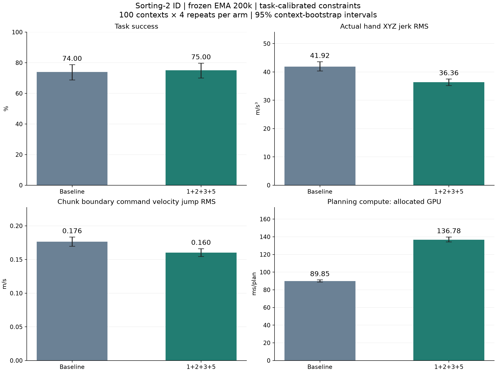

# Sorting-2 ID: 베이스라인과 ①②③⑤ 조합 비교

동일한 100개 초기 배치 × 4회 반복으로 조건당 400회, 총 800회를 완료했습니다. 성공률은 베이스라인 **74.00% (296/400)**, 조합 **75.00% (300/400)**입니다. 성공률 차이(조합−베이스라인)는 **+1.00%p**, context-paired bootstrap 95% CI는 **-3.25 ~ 5.25%p**입니다.

## 지표

| 지표 | 베이스라인 | ①②③⑤ | 차이: 조합−베이스라인 (95% CI) |
|---|---:|---:|---:|
| 성공률 | 74.00% | 75.00% | +1.00%p (-3.25 ~ 5.25) |
| 실제 손 XYZ jerk RMS | 41.9177 m/s³ | 36.3568 m/s³ | -5.5609 (-7.0342 ~ -4.1555); 유효 쌍 400/400 |
| 청크 경계 XY 명령 속도 변화 RMS | 0.1763 m/s | 0.1602 m/s | -0.0161 (-0.0217 ~ -0.0104); 유효 쌍 400/400 |
| XY 명령 jerk RMS | 100.4798 m/s³ | 77.8796 m/s³ | -22.6002 (-25.2054 ~ -19.9911); 유효 쌍 400/400 |
| 정책 내부 계획 시간: rollout별 평균의 평균 | 89.8476 ms/plan | 136.7831 ms/plan | +46.9355 (44.6646 ~ 49.6863); 유효 쌍 400/400 |
| 계획 시간: 전체 호출 가중평균 | 90.146 ms | 137.068 ms | 재계획당, 실행 필터 별도 |
| 실행 필터 시간 / 실제 실행 step | 0.0000 ms | 0.0259 ms | 타이밍 기록 합계 / 실행 step |
| 평균 실행 길이 | 256.99 steps | 253.20 steps | 조기 계획 실패 포함 |

## jerk와 경계 지표의 해석

실제 손 jerk는 저장된 실제 손 XYZ 위치에 초기 위치를 붙여 3차 유한차분을 구한 뒤 dt=0.035초의 세제곱으로 나누었습니다. 각 rollout 내부 L2 jerk의 RMS를 구한 후 rollout별로 평균합니다. 청크 경계 변화는 새 계획의 첫 실제 실행 명령과 직전 실제 실행 명령을 dt로 나눈 두 XY 속도의 차이 L2이며, rollout별 경계 RMS를 평균합니다. 실제 손 움직임과 명령 신호는 구분합니다.

실제 손 jerk 유효 시행 수는 베이스라인 400/400, 조합 400/400입니다. 실행이 3 step 미만이면 jerk는 null로 두었고 0으로 채우지 않았습니다. 경계가 없는 시행도 경계 지표에서 제외하고 유효 분모를 보존했습니다. 평균 표의 조건별 값은 각 조건의 유효 시행 전체를 사용하며, 차이와 CI는 양쪽 모두 유효한 동일 쌍만 사용합니다. 따라서 유효 분모가 다르면 두 조건 평균의 단순 뺄셈과 paired 차이가 다를 수 있습니다.

짧은 시행에 따른 민감도도 확인했습니다. 양쪽에서 실제로 실행된 공통 길이(min(두 실행 길이))로 맞추어 jerk를 다시 계산하면 베이스라인 41.2449, 조합 36.0471 m/s³, 차이 -5.1978 (95% CI -6.6841 ~ -3.8429)입니다. 유효 400/400쌍, 평균 공통 길이 217.89 step입니다. 이 분석 역시 계획 실패나 유효 쌍 선택의 영향을 제거하지 못하므로 전체 길이의 성능으로 확대 해석하지 않습니다.

## 실패와 실행 길이

- 베이스라인 종료 사유: {"success": 296, "step_budget": 104}
- 조합 종료 사유: {"success": 300, "step_budget": 97, "environment_done_without_final_success": 2, "solver_failure": 1}
- 0-step 시행: 베이스라인 0, 조합 0. 3-step 미만: 베이스라인 0, 조합 0.
- 두 조건 모두 성공 260쌍, 베이스라인만 성공 36쌍, 조합만 성공 40쌍입니다.

solver_failure·infeasible 등의 계획/실행 필터 실패는 방법의 평가 결과로 유지했습니다. 파라미터 수정, 실패 시행 재시도, 사례 교체를 하지 않았으며 실패를 성공률 분모에서 제외하지 않았습니다. 계획이 짧게 끝나 jerk가 낮아진 경우를 태스크 수행 개선으로 해석하면 안 됩니다.

## 고정 조건과 메인 코드 적용 범위

- 메인 commit b22441b5ab5d017be82779c259e2787d43ba0d62의 실제 Policy 및 공통 closed-loop 평가 함수를 사용했습니다. ① 매 Euler projection, ② PF2MP guidance, ③ 실행 직전 필터, ⑤ LiPo를 켰고 ④ RTC는 껐습니다.
- Sorting-2 학습 시연과 태스크 정의로 정한 고정 제약입니다. 유효 workspace [0.24, -0.35]~[0.8, 0.45] m, 가속도 14.7 m/s², envelope margin 0.41 m입니다. 최대 학습 가속도×1.05를0.1단위 올림하고, 초기 블록 support 전체와 canonical reset을 포괄하도록 margin을1cm단위 올림했습니다. PF/LiPo는 그대로입니다. TASK_CALIBRATION.json에 계산 근거와100개 초기 배치 zero-action feasibility witness를 기록했습니다. 같은 이미 노출된 ID100개 후속 비교이며 새로운 untouched holdout은 아닙니다.
- Sorting-2의 12차원 관측과 원본 red-box1/blue-box1 명칭을 인식하도록 PF manifest·config 검증 guard와 상태 읽기 wrapper를 확장했습니다. 원본 체크포인트 task 별칭 sorting2를 인정하며 체크포인트나 원본 config는 바꾸지 않았습니다. 제약 방정식이나 QP 알고리즘을 변경하지 않았습니다.
- 개발셋에서 선택된 20만 step EMA와 train-only normalizer를 고정했습니다. 두 조건 모두 plan16/execute8/Euler10, max500, dt0.035초, 지연0입니다.
- 모든 test 100개 × seed0~3의 CPU 해시 난수 흐름과 초기 상태를 두 조건에서 동일하게 사용했습니다. 한 shard의 두 조건은 같은 할당 GPU에서 순차 실행했으며 shard별 실행 순서를 교차했습니다.
- 전체 성공은 빨강 1개·파랑 1개가 모두 각 색상 목표 XY 영역 안에 들어가는 공식 시뮬레이터 판정입니다. 별도 안정 유지 시간은 없습니다. D3IL은 물리 step 전 done, step 후 success를 판정하므로 목표 진입 후 한 step 더 실행될 수 있으며 최종 info success와 실패 유무를 원본 로그로 검증했습니다. 이 평가 루프의 동작을 사후에 바꾸지 않았습니다.
- 기존 ID 74%는 다른 평가 루프와 CUDA 난수 방식의 결과입니다. 이번 베이스라인은 조합과 같은 메인 평가 루프 및 CPU 해시 난수로 새로 평가했으며, 이전 수치와 직접 차이로 해석하지 않습니다.

## 계산 시간과 통계 범위

최대4개의 Slurm GPU job을 동시에 실행했고 각 shard는 할당 GPU 한 개를 사용했습니다. 같은 shard의 두 조건은 같은 GPU에서 순차 실행했습니다. 타이밍은 클러스터 실행 부하와 GPU 배정 차이의 영향을 포함할 수 있습니다. Stacking의 단일 GPU 공유 타이밍과도 구분합니다. 전체 호출 평균은 results.json의 plan_ms를 호출 수로 가중했습니다. paired 시간 차이/CI는 Policy.plan 내부 타이머의 rollout별 평균 차이이며, 호출 전 난수 생성·전송은 제외합니다. 전체 호출 가중평균에는 호출측 타이머가 기록한 난수 생성·전송과 호출 오버헤드도 포함됩니다. 실행 필터 시간은 별도로 표시했으며 계획 시간에 이미 포함된 projection/LiPo/PF 시간과 중복 가산하지 않았습니다. 시뮬레이터까지 포함한 전체 제어 지연이나 단독 실시간 latency를 측정한 것은 아닙니다.

신뢰구간은 동일한 context 100개를 10,000회 bootstrap하고 각 context의 4회 반복을 함께 유지한 percentile 95% CI입니다. 학습 seed는 42 하나이며, 이 CI는 학습 seed 사이의 변동을 반영하지 않습니다.

## 감사와 출처

800개 원본 step 로그에서 성공 판정·누적 명령·이전 행동·실제 손 jerk·경계 변화·QP 호출/상태·LiPo 한도·성공률을 재계산했습니다. smoke 및 본평가의 초기 상태와 seed pairing을 대조했습니다. frozen source/checkpoint/normalizer/protocol/cache hash를 검증하고 실행 소스를 소스 아카이브와 비교했습니다. 전체 train540/val60의 timestamp 부가 데이터 뷰가 원본 배열과 같은지, PF support3000이 train 위치에서 고정 seed로만 선택됐는지, normalizer가 train-only인지 재검증했습니다.

성공한 계획 QP의 최대 저장 잔차는 1.156e-16 m, 재계산한 최종 계획 최대 잔차는 1.014e-09 m입니다. LiPo 반환 전 최대 보정은 0.0003000000 m, float32 반환 행동에서 다시 계산한 최대 누적 보정은 0.0003000125 m입니다. solver 상태별 건수와 실패 단계는 summary.json에 보존했습니다. Safety 지표는 보고에서 제외했습니다.

시연은 기존 Sorting-2 학습에 사용한 원본 상태 PKL 미러 600개, 공식 train540/val60 분할입니다. 공식 ZIP에서 직접 확보한 101개만 바이트 동일성을 대조했으며 나머지 499개는 공식 ZIP과 독립 대조하지 않았습니다. 기존 감사와 초기 아카이브를 보존하고, 이번 전처리 뷰에서도 모든 원본 파일 해시와 배열 일치를 대조했습니다. 평가 context는 기존 ID에서 사용한 공식 2_test_contexts.pkl의 앞 100개이며 원본 파일 SHA256과 기존 400회 평가의 context별 canonical 해시를 대조했습니다. 단일 학습 seed, ID 시뮬레이터 범위이며 OOD 및 실물 성능은 평가하지 않았습니다.

원본 시계열·전체 체크포인트는 별도로 보존합니다. 공개 실행 코드는 경로를 CLI 인자로 변환한 버전입니다.
