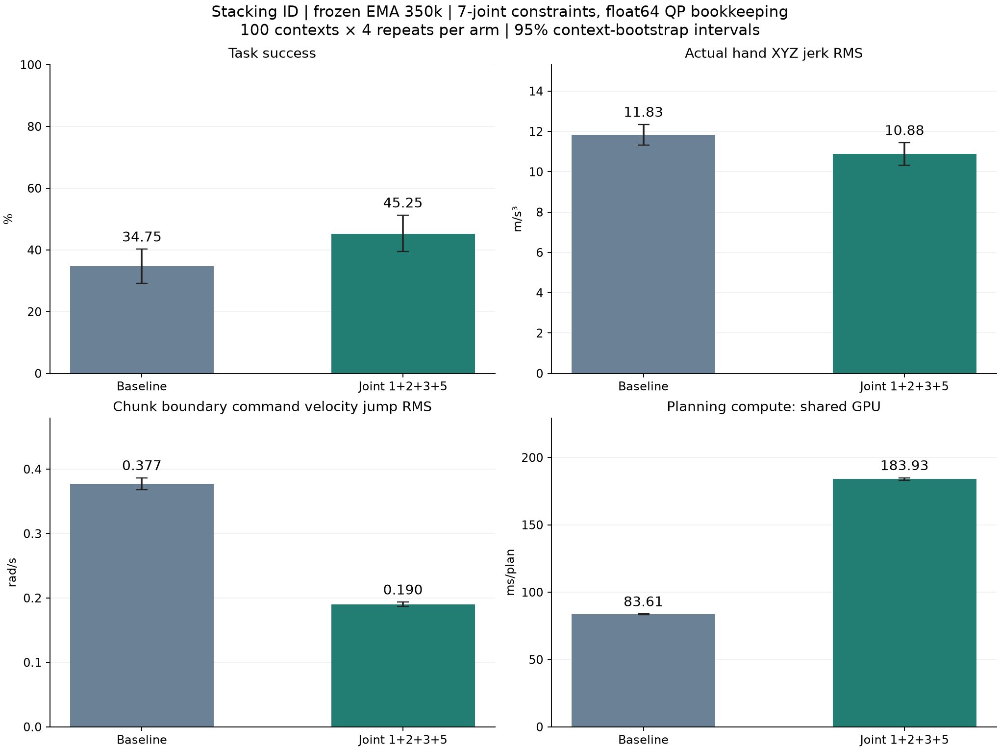

# Stacking ID: 관절 공간 ①②③⑤ 비교

동일한 초기 배치 100개 × 4회, 조건당400회 총800회를 완료했습니다. 성공률은 베이스라인 34.75% (139/400), 관절 조합 45.25% (181/400)입니다. 성공률 차이 +10.50%p, paired95% CI +3.7500 ~ +17.2500%p입니다.

| 지표 | 베이스라인 | 관절 ①②③⑤ | 차이 (paired95% CI) |
|---|---:|---:|---:|
| 실제 손 XYZ jerk RMS (m/s³) | 11.8274 | 10.8753 | -0.9521 (-1.6129 ~ -0.2917); 유효400/400쌍 |
| 실제 7관절 jerk RMS (rad/s³) | 36.1611 | 30.9086 | -5.2526 (-6.7730 ~ -3.7890); 유효400/400쌍 |
| 청크 경계 7관절 명령 속도 변화 RMS (rad/s) | 0.3770 | 0.1902 | -0.1868 (-0.1958 ~ -0.1784); 유효400/400쌍 |
| 7관절 명령 jerk RMS (rad/s³) | 230.6579 | 100.2476 | -130.4103 (-135.8039 ~ -125.3354); 유효400/400쌍 |
| 계획 시간 (ms/plan, rollout별 평균의 평균) | 83.6057 | 183.9314 | 100.3257 (+99.4286 ~ +101.2390); 유효400/400쌍 |
| 평균 실행 step | 869.8675 | 826.0225 | -43.8450 (-70.9003 ~ -17.0733); 유효400/400쌍 |

## 방법과 고정 조건

이 실험은 사용자가 선택한 관절 공간 버전입니다. 메인의 XY 방법을 그대로 실행한 결과가 아닙니다. 35만 step EMA, 기존 train-only 정규화, plan16/execute8/Euler10, dt0.03초, max1000, 지연0을 고정했습니다. 재학습·모델 재선택·test 기반 튜닝은 하지 않았습니다.

①은 매 Euler 단계에서 7개 관절 목표 위치와 축별 가속도 제약에 projection합니다. 관절 위치 범위는 실제 D3IL robot.joint_pos_min/max입니다. 가속도 한도는 학습 시연의 관절 행동 차분에서 관절별 절댓값99.5분위수×1.1로 계산했습니다. 이는 시연 기반 연구 한도이며 실제 로봇의 인증된 물리 가속도 한도가 아닙니다.
가속도 한도(rad/s²): [1.119008854342005, 3.0987575329426273, 2.5856252330251914, 3.870476973243071, 8.33393186330797, 7.991542348431217, 8.445931184622983].

②는 기존 frozen min/max 정규화로 스케일한 7개 목표 관절의 train-only KDE입니다. bandwidth0.15(정규화 단위), weight0.01, alpha−1, support3000, seed42입니다. 거리 항은 train 밀도의 하위5% 기준보다 밀도가 높은 train support anchor에 대한 거리입니다. 기존 2차원 XY raster 대신 7차원 train anchor 집합을 사용한 차원 확장임을 명시합니다. action·첫 관측·그리퍼·물체 채널의 직접 guidance는0입니다.

③은 실행 직전 현재 목표 관절과 직전 실행 행동으로 같은 위치·가속도 제약을 검사하고 최소 수정 QP를 적용합니다. 수정량이1e-7 rad를 넘으면 남은 큐를 폐기하고 재계획합니다. ⑤는 실행된 최근 목표 관절3개와 새 누적 목표에 대한 3차 차분 제곱합을 최소화하며, 누적 관절 위치 보정을 축별0.0003 rad 이내로 제한합니다. 같은 위치·가속도 제약을 함께 만족시킵니다. TCP 공간 workspace/물체 envelope는 적용하지 않았습니다.

그리퍼는 모델 출력을 guidance나 QP로 직접 수정하지 않습니다. 정책의 상태 피드백·모델 채널 간 상호작용으로 두 조건에서 예측 그리퍼 값이 달라질 수는 있습니다. 최종 gripper width>.075이면 열고 아니면 닫는 기존 제어를 유지했습니다.

## 지표와 통계 해석

jerk는 실제 손 XYZ 및 실제 관절 위치에 초기 상태를 붙인 뒤 3차 유한차분/dt³의 L2 RMS를 rollout별로 계산한 평균입니다. 경계 변화는 재계획 청크가 처음 실행될 때 직전/현재 관절 명령 속도의 차이 L2 RMS입니다. 실행3 step 미만의 jerk와 경계가 없는 시행의 경계 지표는 null이며 0으로 대체하지 않았습니다. 성공률은 모든 시행을 포함합니다. 차이/CI는 양쪽 모두 유효한 쌍만 사용하고 분모를 보존했습니다.

종료 사유: 베이스라인 {'success': 139, 'step_budget': 261}, 관절 조합 {'success': 181, 'step_budget': 219}. 0-step 시행은 각각 0, 0개입니다. QP 실패는 정책 결과로 유지하고 성공률 분모에서 제외하지 않았습니다.

같은 쌍의 공통 실행 길이로 맞춘 실제 손 jerk 차이는 -0.8625 m/s³ (95% CI -1.5085 ~ -0.2245)입니다. 이 역시 종료 시점/실패 선택 영향을 완전히 제거하지 못하므로 전체 수행 개선으로 단정하지 않습니다.

초기 배치100개를10,000회 bootstrap하고 각 배치의4회 반복을 함께 유지한 percentile95% CI입니다. 같은 CPU 해시 난수 흐름과 초기 상태를 양쪽에 사용하고 shard별 실행 순서를 교차했습니다. 학습 seed는42 하나이며 학습 seed 변동은 이 CI에 포함되지 않습니다.

전체 계획 호출 가중평균은 베이스라인 83.595, 관절 조합 184.867 ms입니다. 실행 필터 시간/실제 실행 step은 0.0000, 0.0269 ms입니다. 한 RTX3090에서4개 worker가 공유해 혼잡을 포함하며 단독 latency나 전체 제어 지연 측정이 아닙니다.

## 검증과 범위

원본800회에서 색상/높이 성공 판정, 부분 목표 진입 이력, 누적 관절 명령, 실제 손·관절 jerk, 청크 경계 변화, QP 상태/호출/잔차, LiPo 보정 한도, 그리퍼 채널 보존을 재검산했습니다. 학습 시연1001개로만 계산한 정규화·가속도 한도·PF support를 재검증했습니다. 체크포인트·normalizer·context·source·프로토콜·cache의 frozen 해시와 초기 상태/난수 pairing을 감사했습니다.

원본 vision-state 미러1094개는 release 해시와 일치하지만 공식 ZIP 직접 바이트 비교는0개입니다. 학습1001/검증93 release 분할을 유지했습니다. 평가 배치는 기존 공식 manager 분포에서 새로 만든 고정 ID100개이며 공식 배포 benchmark test 파일과 같다고 주장하지 않습니다. 기존34.5%는 다른 평가 루프/CUDA 난수 방식이므로 참고값이며 이번 동일 루프의 베이스라인과 직접 비교합니다. 성공은 모든3물체가 목표XY반경6cm 이내이고 모든 쌍Z차이3cm 초과인 순간 판정이며 안정 유지 시간 기준은 없습니다. 부분 성공은 목표 영역 진입 이력이며 안정된1단/2단 쌓기로 해석하지 않습니다. 단일 학습 seed의 ID 시뮬레이터 결과이며 OOD/실물 성능은 평가하지 않았습니다. Safety 지표는 요청대로 제외했습니다. 원본 시계열 자료는 별도로 보존합니다.

LiPo QP에서 기록한 최대 누적 보정은 0.0003000000 rad, float64 계획을 복원해 재계산한 최대 누적 보정은 0.0003000000 rad입니다. 설정 한도는0.0003 rad이며 반환 표현의 유한 정밀도를 함께 기록했습니다. 성공한 최종 관절 계획의 최대 재계산 잔차는 1.251e-14 rad입니다.

## v2 수치 수정과 해석

신경망과 베이스라인은 원래 float32를 유지합니다. 제약 조합의 latent·정규화·QP 반환은 float64로 유지하고 모델 호출에만 임시 float32 입력을 사용합니다. 관절 제약 anchor는 반올림된 관측 대신 실제 실행 목표 관절입니다. 허용 잔차1e-8 rad, 모든 제약·PF·LiPo 한도는 v1과 동일합니다. OSQP 수렴 실패 시 동일한 최소 수정 QP를 Clarabel로 다시 풀며 동일한 잔차 검사를 적용합니다. 기존97개 실패 입력을 회귀검사했습니다. 같은 이미 노출된 ID100개를 재평가하는 후속 실험이며 새로운 독립 holdout은 아닙니다.
